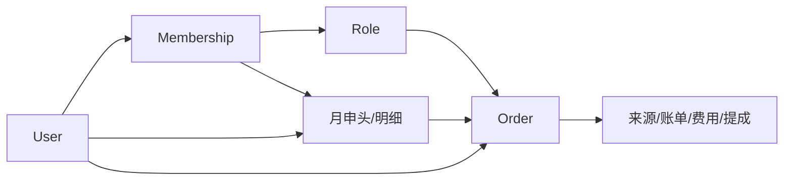

# 授权父行与订单锁序修复验收

## 实施范围与最终锁序

- 整票审核 `Act`：`User SHARE → Membership SHARE（ID 升序）→ Role SHARE（ID 升序）→ Order UPDATE → 实时同一 grant 校验 → 费用/事件写入`。父锁持有至事务结束，授权判断保留用户、成员、角色有效性及组织范围。
- 补录预览、批准、驳回：共享事务先调用 `HasRealtimeLockGrant` 取得上述授权父锁和实时资格，再锁 `Order → 补录申请 → 提成父单/调整`。专用作废仓储同样先授权父锁，后订单锁。创建/本人撤回不取得审核授权父锁。
- 月申提交/重提：`User NO KEY UPDATE → 当前组织 Membership UPDATE → 申请头/明细（存在时）→ Order → 来源/账单/费用 → 归属/提成/方案`。循环来源和受控创建再次读取本人 User 时，只重入入口已持有的锁。
- 直接计提创建：`GetGenerationContext(employeeID)` 在共享事务入口先锁 `User NO KEY UPDATE`，再锁 `Order → 来源`；计算内核同样先 User，后来源订单，避免外层入口反序。
- 单笔确认：预读不可变 EmployeeID，先锁 `User NO KEY UPDATE`，再锁 `Order → 来源 → 提成父单` 并复核来源指纹、版本状态。
- 月申批准：预读不可变 EmployeeID，先锁 `User NO KEY UPDATE`，再锁 `申请头/明细 → Order → 来源 → 提成父单`。避免同本人重提产生 `Header → User` 与 `User → Header` 环。
- 整批确认辅助：预读提成员工集合，员工 UUID 升序锁 `User NO KEY UPDATE`，只读收集全部来源的订单集合并与已有关联提成行合并，再按 UUID 升序一次锁 Order；随后逐笔重算与最终父单锁内版本复核。



方案写入路径持有 Membership 后只普通读取 User，但插入分配会通过外键申请 User KEY SHARE；提成快照锁使用 NO KEY UPDATE，与 KEY SHARE 兼容，防止形成隐式反序。NO KEY UPDATE 仍阻断账号实际更新和费用审核 SHARE，不削弱快照稳定性。账号/成员维护原有 User→Membership 顺序与本次保持一致。未修改现有方案生效、历史员工资格或组织范围语义。

### 完整集合约束

确认入口不能仅按员工归属裁剪后的提成行预锁：首次必须锁该来源全部应收订单。整批确认、月申提交/重提必须在处理任何一个来源之前合并所有相关来源订单、全局排序一次预锁。月申提交固定轻量来源 ID 集合后复用该集合进行逐来源复核，不在预锁后重新发现来源；只读候选仍按归属月窗口处理，日期与截止口径保持一致。

## 实际验证结果

以下真实 PostgreSQL 命令均经独立验收数据库环境执行；使用正式迁移初始化的隔离 schema，未修改日常开发库记录，未发送钉钉通知。

1. 审核/月申交叉及实时账号停用，3 项实际 PASS，9.242s：

   ```bash
   node --env-file=/tmp/roncin-fee-approval-db.env scripts/run-with-env.mjs go -C server test ./internal/data -run 'TestOrderFeeReview(Monthly.*LockOrder|ConcurrentUserDisable)Postgres' -count=1 -v
   ```

   - 月申已持有 User/Membership 时审核不得先占 Order。
   - 审核持有 User SHARE 时月申不得先占 Membership 再等待 User。
   - 停用事务先持有 User 锁时，审核等待后必须以最新资格拒绝；费用包保持 PENDING。

2. 补录及直接提成相邻入口，2 个顶层测试、7 个子项实际 PASS，16.285s：

   ```bash
   node --env-file=/tmp/roncin-fee-approval-db.env scripts/run-with-env.mjs go -C server test ./internal/data -run 'Test(FeeSupplement|Commission)MonthlyParentLockOrderPostgres' -count=1 -v
   ```

   - 补录预览、批准、驳回、已批准费用专用作废，各与月申 User/Membership 持锁路径交叉。
   - 完整提成用例创建（含 GetGenerationContext）、单笔确认、共享事务整批确认，各与月申父锁路径交叉。

3. 月申批准与本人重提申请头锁序，1 项实际 PASS，2.220s：

   ```bash
   node --env-file=/tmp/roncin-fee-approval-db.env scripts/run-with-env.mjs go -C server test ./internal/data -run 'TestCommissionApplicationApproveParentLockOrderPostgres' -count=1 -v
   ```

4. 定向纯 Go 与 sqlmock 验证实际 PASS：

   ```bash
   go -C server test ./internal/biz ./internal/data -run 'TestCommissionRepoGetGenerationContextLocking|TestSupplementPreviewRejectsStaleOrUnauthorizedRequest' -count=1
   go -C server test ./internal/biz ./internal/data -run 'Test(CommissionRepoGetGenerationContextLocking|SupplementPreviewRejectsStaleOrUnauthorizedRequest|Commission.*Create|Commission.*Confirm)' -count=1
   git diff --check
   ```

并发测试通过 Ent 查询拦截器仅同步目标请求到首次 User 查询，真实 SQL、事务和 PostgreSQL 行锁全部执行生产路径；无需固定休眠，不依赖碰巧发生的并发调度。每个测试设 10 秒上限，出现反序死锁或阻塞会明确失败。

## 文件责任

- `server/internal/data/order_fee_review.go`：授权父锁抽取与审核入口预锁。
- `server/internal/biz/order_fee_supplement_usecase.go`、`server/internal/data/order_fee_supplement_cancel.go`：补录事务编排及作废预锁。
- `server/internal/data/finance_commission_application_submit.go`、`finance_commission_application_decision.go`：月申提交/重提/批准父行锁序。
- `server/internal/data/finance_commission_write.go`：单笔和整批确认员工预锁。
- `server/internal/biz/finance_commission{,_lifecycle,_types,_test}.go`、`server/internal/data/finance_commission_test.go`：生成上下文 employeeID 内部接口同步及定向 sqlmock。
- `server/internal/data/order_fee_review_parent_lock_integration_test.go`：上述真实库并发回归。
- `finance_commission_calculation.go` 由金额/契约代理同步了 GetGenerationContext 签名与员工预锁、计算内核 User 前移，本报告记录整合后的实际顺序。

主代理负责后续全量真实库门禁与最终审查，不重复运行大范围全测。

## 二次审查发现的相邻并发缺陷及最终复核

- 两员工各归属一个订单、但来自同一对冲来源时，原确认先锁各自提成行订单再追加来源全集，会死锁。临时 overlay 仅恢复子集预锁后，新的单笔/整批确认回归均实际 FAIL（服务将锁内解析失败映射为 FINANCE_COMMISSION_SOURCE_CHANGED），日志 `/tmp/roncin-fee-lock-order-set-old-repro.log`。修复后两项实际 PASS，8.784s，日志 `/tmp/roncin-fee-lock-order-set-fixed.log`。
- 方案分配持 Membership、插入 assignment 取得 User 外键 KEY SHARE，与月申原 User UPDATE 发生隐式环。独立审查真实 PG 已复现 SQLSTATE 40P01，日志 `/tmp/roncin-fee-rule-fk-lock-repro.log`。统一提成 User 快照锁为 NO KEY UPDATE 后，新增正式回归实际 PASS，2.09s；没有改动方案写入范围。
- 最终锁强度和联合集合落地后，所有新增并发回归组实际 PASS，44.207s，日志 `/tmp/roncin-fee-lock-final-concurrency.log`：

  ```bash
  node --env-file=/tmp/roncin-fee-approval-db.env scripts/run-with-env.mjs go -C server test ./internal/data -run 'TestCommissionEmployeeSnapshotForeignKeyLockPostgres|TestCommissionConfirmationFullOrderSetPostgres|TestOrderFeeReview(Monthly.*LockOrder|ConcurrentUserDisable)Postgres|Test(FeeSupplement|Commission)MonthlyParentLockOrderPostgres|TestCommissionApplicationApproveParentLockOrderPostgres' -count=1 -v
  ```

- 完整月申相邻组（含财务批准/驳回/并发决策、提交、候选、显式重提及快照刷新）与原新增并发组实际 PASS，120.260s，日志 `/tmp/roncin-fee-lock-final-tests.log`。该轮在 NO KEY UPDATE 追加前执行，最终相同月申组交由主代理全量复核。
- `go -C server test ./internal/service ./internal/biz -count=1`：service 0.956s、biz 1.714s，实际 PASS；全仓 `GetGenerationContext` 均已同步 employeeID 第五参，包含 service stub。
- 增加 `finance_commission_order_set_lock_integration_test.go`、`finance_commission_employee_fk_lock_integration_test.go` 两个正式真实库回归文件。新增 helper `commissionEmployeeSnapshotLock` 使用 Ent `LockOption.Strength = sql.LockNoKeyUpdate`，没有手写 SQL 或修改生成文件。
